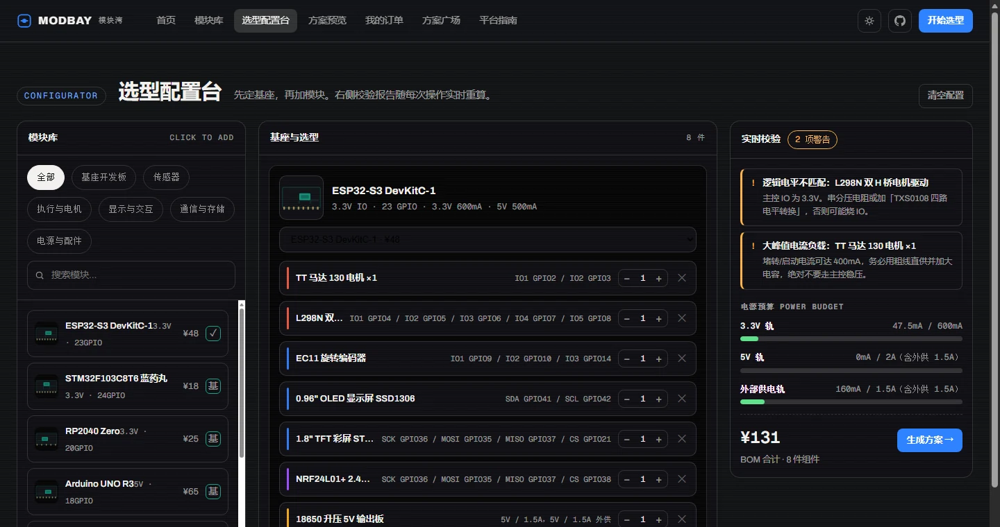
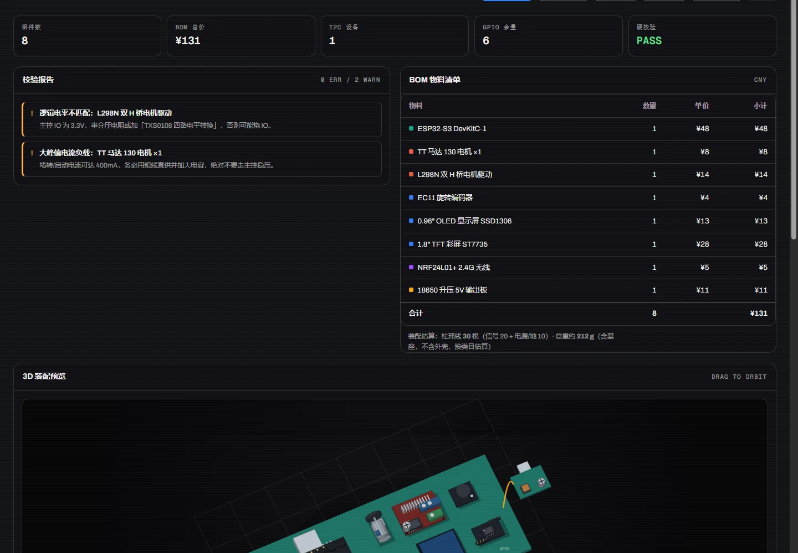
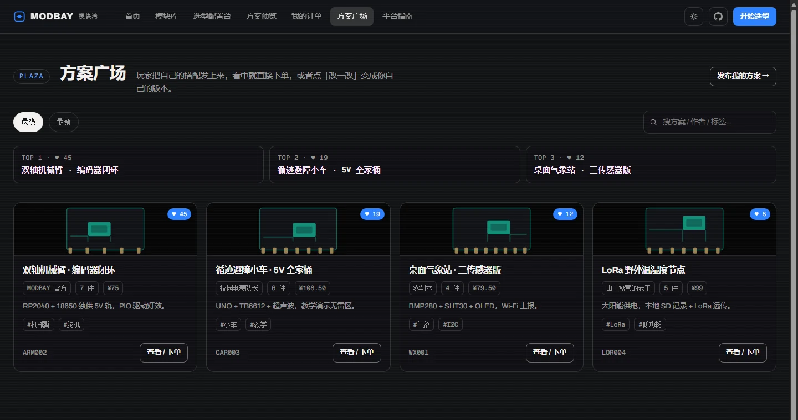

# MODBAY 模块湾

**把「选什么、怎么接、带不带得动、代码怎么写」收敛成一次点击。**

面向 DIY 硬件与创客教育的方案智能定制平台。用户在线组合主控与功能模块，平台在选型过程中实时完成电气校验，一次输出可打样的图纸、可下单的物料清单和可烧录的软件工程。

| 指标 | 现状 |
| --- | --- |
| 器件建模 | 58 件（7 款主控 + 51 个功能模块），按数据手册逐项建模 |
| 校验规则 | 9 类，覆盖引脚、地址、电源、电平、总线 |
| 软件生成 | 一次产出 20 余文件 / 600 余行，双语言目标 |
| 自动化测试 | 174 条（引擎 20 + 界面 154） |
| 交付形态 | 散件包 / 焊接成品板 / 软件包，三档并行 |

---

## 一、问题：门槛不在买，而在接

开源硬件已经解决了「买得到」：一块 ESP32 不到五十元，一个温湿度传感器不到十元，次日可达。但器件可得性的提升，并没有降低「把器件组装成能工作的系统」的难度。

初学者真正卡住的四个环节：

- **引脚分配**——主控 IO 有限，串口 / SPI / I2C 占固定脚，剩余还要避开启动脚与仅输入脚。选错一个，程序跑不起来，报错还指向别处。
- **地址冲突**——同一条 I2C 挂两个默认 0x76 的气压计，表现为其中一个永远读不到数据，而总线扫描看起来一切正常。
- **供电能力**——板载稳压只有几百毫安，舵机堵转、电机启动的瞬态电流远超典型值，表现为「程序随机重启」「屏幕闪烁」。
- **逻辑电平**——5V 器件直连 3.3V 主控，轻则通信不稳，重则烧 IO。

这四类问题的共同点：**错误发生在物理层，症状出现在软件层**。缺少把两者对应起来的知识，就只能靠论坛提问和反复换件试错，一个想法到能跑平均要两到四周。

现有生态的三层支持各有缺口：器件电商给参数不给方案，套件厂商只管自己那套，内容社区的教程是静态的、不随用户选型变化。**没有一层在「用户的具体组合」上做校验**——而这正是用户真实面对的问题。

---

## 二、解法：把电气规则编译成实时约束

平台把器件变成结构化数据，把电气规则变成可执行判定，在用户操作瞬间给出结论。

九类规则分三档输出：

| 档位 | 触发 | 处理 |
| --- | --- | --- |
| 硬错误 | 引脚不足、地址冲突、电源超载 | 必须改方案才能继续 |
| 警告 | 峰值超降额容量、电平不匹配但有转换件、只选主控没选模块 | 可继续，但给出可执行建议 |
| 通过 | 总线共享、余量统计、可焊接性 | 记录到方案摘要 |

电源预算不是简单加电流，而是引入三个工程系数：安全降额 0.8（留启动与温升余量）、链路效率（升压 88% / 外供 85%，反推电池侧需求）、线阻压降（0.08 Ω 每根杜邦线、往返计算）。由此给出峰值判定、线损告警、滤波电容建议（每 100 mA 配 100 µF）、升压链路折算。



---

## 三、产品：从方案到交付的完整链路

### 1. 选型与实时校验

六大类器件（基座 / 传感器 / 执行电机 / 显示交互 / 通信存储 / 电源配件），分类筛选 + 关键词搜索 + 三种排序。每件器件带完整电气参数：接口类型、I2C 地址、供电轨、逻辑电平、典型与峰值电流、规格表。

配置台三栏布局：左侧模块库点击即加、中间方案清单可调数量、右侧实时校验与预算。选型过程持久化，分享链接可还原完整方案。

### 2. 三维装配预览

采购前先看清成品形态。自研 SVG 软件渲染器，不依赖 WebGL 与任何三维库：旋转矩阵投影、法线背面剔除、方向光加高光、画家算法排序，并用图层分组解决「大面片遮挡」这一经典缺陷。45 种以上模块按真实零件建模——排针、屏蔽罩、散热片、超声波双探头、舵机舵盘、18650 电芯、车轮。

底板长宽随选型自动伸缩，模块按实测包围盒分行居中、带接触阴影与排母底座。拖拽旋转、滚轮缩放、点击模块看参数。

### 3. 接线图与底板设计

接线图用**母线式布线**：地线与电源各一条垂直干线，模块用短支线取电；信号按总线收敛为若干主干（如「SPI ×5」），模块从主干水平分支。十九根独立走线压缩成三到五条束——这是真实排线图的画法，也是初学者最不容易看错的形式。

底板设计图以毫米为单位生成：板框、四角 M3 安装孔、2.54 mm 排针焊盘阵列、电源母线走廊、尺寸标注，并输出层数、板厚、铜厚、最小线宽孔径等工艺参数与按面积计价。电机、舵机等机械件标记为板外件，不占底板面积。



### 4. 软件方案生成

这是与「卖器件」拉开差距的部分。生成器把选型结果编译为一套可落地的工程：

- **板级支持包**——引脚宏、总线初始化、上电自检。引脚值全部来自真实分配结果，不是占位符。
- **器件驱动**——19 种驱动类，覆盖寄存器型 I2C、单总线、脉冲测距、模数采样、舵机、灯带、直流电机、步进、显示、编码器、矩阵键盘、SPI 器件、串口透传，含时序实现与错误处理。
- **联动逻辑**——由「传感器 × 执行器」自动配对，内置避障、温控、浇水、气体报警、光控、姿态反馈、旋钮菜单、电量显示、位置上报等 11 条规则。
- **通信协议**——MQTT（四类主题 + 指令分发）、HTTP 上报、Modbus RTU 从站（寄存器映射 + CRC16）。
- **双目标**——MicroPython 版本可直接烧录运行，C 版本为 ESP-IDF 骨架，含 I2C 探测自检。

### 5. 交易与履约

方案页直接可下单。平台自动推断配套件（电池盒、船型开关、保险丝、杜邦线、螺丝、亚克力底板），并按「散件包 / 焊接成品」两个档位报价：焊接按焊点计价（0.8 元/点，设最低值），打样按面积与焊盘数估算。两个档位对应不同的履约流程——散件三步，成品六步（底板设计 → 打样 → 焊接 → 测试 → 配货 → 发货），订单状态机按档位分支推进。



---

## 四、系统架构

平台是**前端渲染层 + 服务网关**的双层结构，不是一次性静态页面：

```
┌─────────────────────────────────────────────────┐
│  客户端（浏览器 / 平板 / 手机）                    │
│  选型引擎 · 三维渲染 · 接线布线 · 代码生成         │
│  离线可用，方案存本地，分享链接可还原              │
└───────────────────┬─────────────────────────────┘
                    │ HTTPS / JSON
┌───────────────────▼─────────────────────────────┐
│  服务网关（Node，零第三方依赖）                    │
│  ├ 支付：微信 / 支付宝下单、状态轮询、异步回调      │
│  ├ 方案广场：发布 / 列表 / 点赞 / Remix            │
│  ├ 订单：创建、状态流转、履约推进                  │
│  └ 静态资源与健康检查                             │
└───────────────────┬─────────────────────────────┘
                    │
┌───────────────────▼─────────────────────────────┐
│  规划中的云服务层                                 │
│  账户体系 · 订单持久化 · 方案市场 · 履约工单       │
│  器件库版本化 · 用量分析 · 供应链对接              │
└─────────────────────────────────────────────────┘
```

**为什么这样分层**：选型校验是纯计算，放客户端既快又省服务器；支付与交易必须可信，放服务端；器件库与方案库需要版本管理和多人协作，放云端。当前服务网关已实现支付与广场接口，云服务层按路线图推进。

技术选型上刻意保持轻：前端零构建、零框架依赖，首屏约 1.5 MB（含 58 张器件图），低端手机与老旧浏览器可跑；服务端只用 Node 内置模块，部署无依赖安装步骤。这不是「为了简单而简单」——它让整套系统可以塞进一台最低配云主机，也让它能被任何工程师在一天内接手。

---

## 五、技术壁垒

**1. 把电气规则编译成实时约束。** 难点在耦合：改一个模块会同时影响引脚池、地址表、电源预算与电平判定，必须一次重算全局状态而非局部修补。实现上分离「分配器」与「校验器」，两者共享同一份器件描述。

**2. 零依赖三维渲染。** WebGL 在低端机与旧浏览器上兼容性不稳、首屏体积大。用二维矢量做三维投影，通过图层分组解决大面片遮挡，通过顶点云计算全周最坏取景避免旋转时画面抽动。

**3. 硬件到软件的连续交付。** 行业把「卖器件」与「给代码」分开：器件商给手册，代码靠社区。本项目让代码直接由选型生成，引脚宏与真实分配一致，地址取自器件数据，联动规则由实际组合推导。

**4. 底板图按实物尺寸自动生成。** 模块尺寸纳入器件数据，按行装箱、居中排布、自动布设电源走廊，输出可直接打样的图纸。一位教师为三十名学生备课时，不必重复画三十次底板。

**5. 服务链闭环。** 从方案到配套件推断、到交付档位、到履约状态机，把「方案」变成「可交付的商品」。

真正难复制的是**器件数据的颗粒度**：58 件器件的引脚、地址、电流、电平、尺寸逐项核对，这是时间堆出来的资产，不是功能堆出来的。

---

## 六、商业模式

硬件负责获客与现金流，软件负责毛利，两者解耦定价。

| 收入项 | 计价方式 | 毛利特征 |
| --- | --- | --- |
| 硬件（散件包） | 物料 + 配套件 | 低，走量 |
| 硬件（焊接成品） | 上述 + 打样 + 焊接工时 + 测试 | 中，含服务溢价 |
| 软件（驱动完整包） | 按驱动数与协议链路报价 | 高，边际成本近零 |
| 软件（云端对接包） | MQTT / HTTP / Modbus + OTA | 高 |
| 软件（定制交付） | 私有协议、实时性调优、产线工装 | 高，人力密集 |
| 方案分成（规划） | 用户方案被复用时抽成 | 高 |

用户可只买方案不买器件，也可只买软件不买硬件。器件价格透明、比价激烈，但软件与服务的定价空间独立——这是模式能跑通的前提。

**目标用户**：高校工科学生（课程设计、竞赛、毕设）、中小学创客与信息技术教师（批量复现、课前预验证）、小型硬件团队（快速验证原型）。

---

## 七、路线图

| 阶段 | 目标 | 可验证结果 |
| --- | --- | --- |
| 已完成 | 选型、校验、三维、接线、底板、软件生成全链路 | 174 条自动化测试通过 |
| 进行中 | 器件库 58 → 120 件；云服务层（账户 / 订单 / 方案市场） | 新增器件通过数据校验；接口联调 |
| 近期 | 江苏落地，入驻 OPC 空间；3 所院校课程共建 | 营业执照、课程方案 |
| 中期 | 履约上线：打样、焊接、测试、发货打通 | 首批成品板交付 |
| 远期 | 覆盖长三角，器件库 300 件，方案分成上线 | 用户数与营收指标 |

---

## 八、运行与部署

### 本地运行

```bash
# 只跑前端（选型 / 校验 / 出图 / 代码生成全部可用）
python -m http.server 8321
# 打开 http://127.0.0.1:8321/

# 跑完整栈（含支付网关与方案广场 API）
node server/server.js
```

Windows 下双击 `start.bat` 亦可。

### 演示环境

| 平台 | 用途 | 说明 |
| --- | --- | --- |
| Cloudflare Pages | 产品演示 | 构建命令 `mkdir -p dist && cp index.html site.webmanifest _headers dist/ && cp -r assets dist/`，输出目录 `dist` |
| Vercel | 预览与灰度 | 已带 `vercel.json`（缓存分级 + 安全响应头） |
| GitHub Pages | 文档与镜像 | `.github/workflows/pages.yml` 自动部署，发布前跑引擎测试 |

> 静态托管只承载**前端演示**。支付、广场、订单依赖服务网关，生产环境部署为常驻 Node 服务（Railway / Render / 自有云主机），前端把 `assets/pay-config.js` 的 `apiBase` 指向该域名即可，代码无需改动。

---

## 九、测试

```bash
node test-engine.js        # 选型引擎 20 条用例
# _domtest.html            # 浏览器端 154 条交互回归（需 http 打开）
```

界面回归覆盖：路由、选型、校验渲染、三维交互、接线图、底板图、软件方案面板、自由画板拖拽、下单支付、后台推进。

---

## 十、目录结构

```
modbay/
├── index.html                  入口
├── assets/
│   ├── data-boards.js          7 款主控（引脚池 / 总线 / 电源轨容量）
│   ├── data-modules-1..3.js    51 个功能模块（电气 + 几何 + 价格）
│   ├── data-presets.js         预设方案
│   ├── app-core.js             状态 / 引脚分配 / 校验引擎 / 电源预算
│   ├── app-views-*.js          首页 / 模块库 / 配置台 / 方案页 / 指南
│   ├── app-3d-parts.js         3D 零件库（盒 / 圆柱元语 + 器件零件）
│   ├── app-3d-scene.js         45+ 模块的装配配方
│   ├── app-3d.js               SVG 软渲染（投影 / 剔除 / 光照 / 画家算法）
│   ├── app-codegen.js          软件方案生成（BSP / 驱动 / 联动 / 协议）
│   ├── app-board.js            底板设计图（mm 级 SVG）
│   ├── app-canvas.js           自由画板（拖拽重排 + 连线重算）
│   ├── app-orders.js           订单域（下单 / 支付 / 后台推进）
│   ├── app-plaza.js            方案广场
│   ├── icon-system.js          图标系统（30+ 线性图标 / 品牌标识）
│   ├── anim.js + style-motion.css   动效层
│   ├── mod/                    58 件器件产品图（WebP，统一深色背景）
│   ├── shots/                  产品界面截图
│   └── icons/                  站点图标（favicon / PWA）
├── server/
│   ├── server.js               HTTP 服务：静态 + 支付 API + 广场 API
│   └── gateway.js              微信 / 支付宝下单与回调
├── _headers                    Cloudflare 响应头与缓存策略
├── vercel.json                 Vercel 配置
├── .github/workflows/pages.yml GitHub Pages 自动部署
├── test-engine.js              引擎单测
└── _domtest.html               界面回归测试
```

---

## 十一、说明

器件价格、电流、引脚参数为教学演示量级（参考常见公开报价与数据手册量级估算），非采购报价；电源供给按板载稳压能力简化建模。订单、支付、履约当前为完整流程的模拟实现，接入真实支付需配置商户密钥（见 `server/gateway.js`）。

本项目为原创，计算机软件著作权登记已提交（源程序文档 60 页、软件说明书 17 页）。
